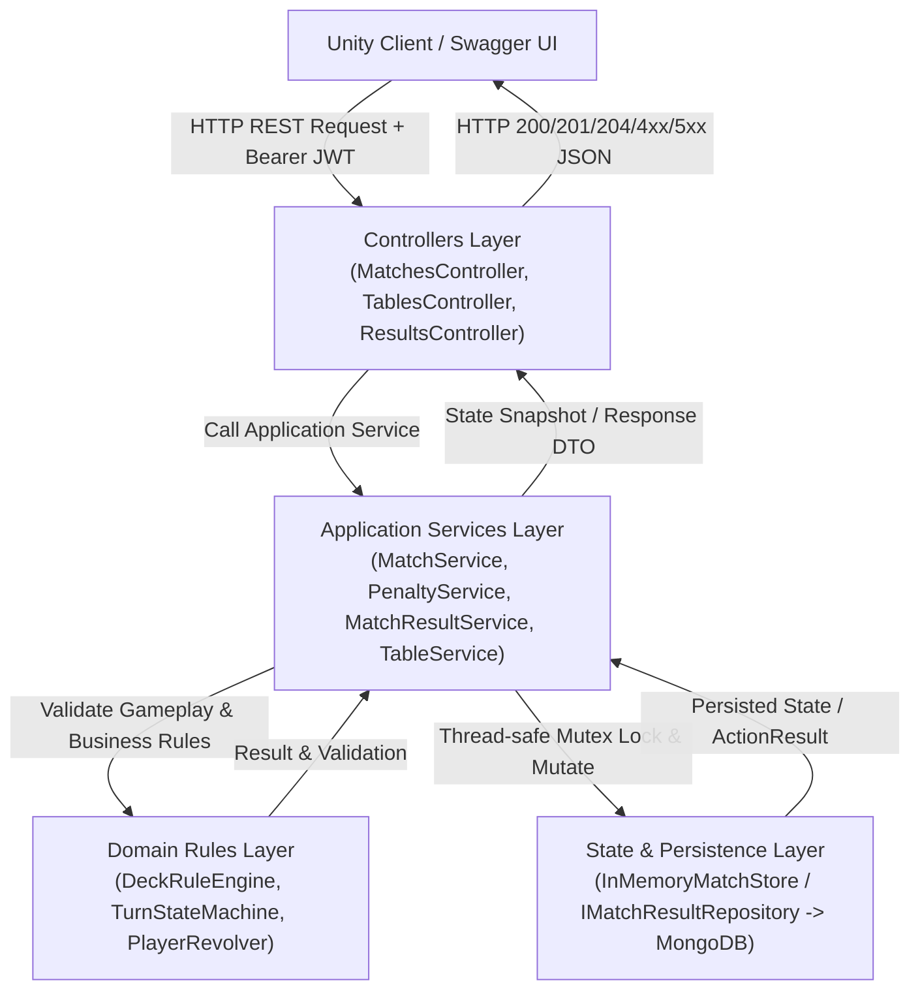

# LIARS CARD — TÀI LIỆU LUỒNG KIẾN TRÚC & API BACKEND DO TUÂN PHỤ TRÁCH

Tài liệu này mô tả chi tiết kiến trúc, đường đi dữ liệu, quy tắc phân lớp, các API Swagger và logic nội bộ cho 6 chức năng Backend của game **LIARS CARD** do thành viên **Tuân** phụ trách:
1. **Tính hình phạt (Penalty Calculation)** — Hoàn thiện
2. **ACK và kết thúc animation (Animation ACK & Timeout Fallback)** — Hoàn thiện
3. **Loại người chơi và xét thắng (Player Elimination & Winner Determination)** — Hoàn thiện
4. **Điều phối sau hình phạt (Post-Penalty Round Transition)** — Hoàn thiện
5. **Lưu và xem kết quả trận (Match Result Persistence & Query)** — Hoàn thiện
6. **Tạo phiên trận từ bàn (Match Session Creation from Table & Network Handoff)** — Hoàn thiện

---

## 1. TỔNG QUAN KIẾN TRÚC PHÂN LỚP (AUTHORITATIVE SERVER ARCHITECTURE)

Hệ thống tuân thủ chặt chẽ mô hình phân lớp Authoritative Server:



- **Controller**: Tiếp nhận request HTTP, kiểm tra Authorization Bearer Token (JWT), lấy danh tính `playerId` (`sub`), không chứa game rules.
- **Application Service**: Điều phối nghiệp vụ, quản lý luồng xử lý, đảm bảo tính Idempotency thông qua `ActionId`, áp dụng khóa `LockMatchAsync` tránh race condition.
- **Domain Rules**: Kiểm tra tính hợp lệ của lượt đánh, tố cáo, xáo bài, chia bài, tính toán buồng đạn súng Nga (RNG do server quản lý 100%).
- **State & Persistence**:
  - `InMemoryMatchStore`: Lưu trữ trạng thái in-memory tốc độ cao, thread-safe bằng `ConcurrentDictionary` và `SemaphoreSlim`.
  - `MatchResultRepository`: Lưu trữ bền vững kết quả trận đấu vào MongoDB collection `MatchResults` với Unique Index trên `MatchId`, tích hợp in-memory fallback khi MongoDB offline.

---

## 2. BẢNG TỔNG HỢP 6 CHỨC NĂNG & ĐIỂM TIẾP NHẬN

| STT | Chức năng | Loại xử lý | Method | Endpoint / Service | Trạng thái |
|:---:|---|:---:|:---:|---|:---:|
| **1** | **Tính hình phạt** | REST API & Internal | `POST` | `/api/matches/{matchId}/deck/pull-trigger`<br/>*Internal:* `PenaltyService.PullTriggerAsync` | **Hoàn thành** |
| **2** | **ACK & kết thúc animation** | REST API | `POST` | `/api/matches/{matchId}/penalty/ack`<br/>*Internal:* `MatchService.AcknowledgePenaltyAsync` | **Hoàn thành** |
| **3** | **Loại người chơi và xét thắng** | Server Nội bộ & State API | `GET` | *State:* `GET /api/matches/{matchId}/state`<br/>*Internal:* `MatchService.EliminatePlayer`, `CheckWinner`, `FinishMatchAsync` | **Hoàn thành** |
| **4** | **Điều phối sau hình phạt** | Server Nội bộ | `Nội bộ` | `PenaltyService.CompletePenaltyAndTransitionAsync`<br/>Fallback Timeout: `ProcessPenaltyTimeoutAsync` | **Hoàn thành** |
| **5** | **Lưu và xem kết quả trận** | REST API & MongoDB | `GET` | `GET /api/matches/{matchId}/result`<br/>*Internal:* `MatchResultService.SaveMatchResultAsync` | **Hoàn thành** |
| **6** | **Tạo phiên trận từ bàn & Handoff** | REST API | `POST`<br/>`GET`<br/>`POST` | `POST /api/tables/{tableId}/start-match`<br/>`GET /api/tables/{tableId}/handoff`<br/>`POST /api/matches/{matchId}/join` | **Hoàn thành** |

---

## 3. CHI TIẾT LUỒNG DỮ LIỆU TỪNG CHỨC NĂNG

### CHỨC NĂNG 1 — TÍNH HÌNH PHẠT (PULL TRIGGER)

- **Mục tiêu**: Người chơi bị phạt chủ động bóp cò súng Nga (Russian Roulette). Server sinh buồng đạn ngẫu nhiên bảo mật 100%, client không thể can thiệp sống/chết.
- **Đường đi dữ liệu**:
  $$\text{Unity / Swagger} \xrightarrow{\text{POST /api/matches/\{id\}/deck/pull-trigger}} \text{DeckActionsController} \xrightarrow{} \text{PenaltyService.PullTriggerAsync} \xrightarrow{} \text{PlayerRevolver.PullTrigger} \xrightarrow{} \text{IMatchStore} \xrightarrow{} \text{PullTriggerResponse}$$
- **Quy tắc**:
  1. Chỉ người bị phạt (`match.PenalizedPlayerId == playerId`) mới có quyền bóp cò.
  2. Ổ quay 6 buồng đạn, 1 viên đạn ngẫu nhiên `BulletChamber`. Bóp cò trúng đạn: `IsBulletHit = true`, `player.IsAlive = false`, xóa sạch hand bài. Bóp cò rỗng: `Survived = true`, sống sót.
  3. Cơ chế Idempotency: `request.ActionId` được cache kết quả, retry không tính bóp cò 2 lần.
  4. Sau khi bóp cò, sinh `CurrentPenaltyEventId`, lưu `PenaltyResolved = true` và khởi động bộ hẹn giờ Timeout Fallback.

---

### CHỨC NĂNG 2 — ACK VÀ KẾT THÚC ANIMATION

- **Endpoint**: `POST /api/matches/{matchId}/penalty/ack`
- **Mục tiêu**: Client báo cáo đã xem xong animation bị bắn / súng nổ / gõ cọc để server chuyển sang vòng mới.
- **Đường đi dữ liệu**:
  $$\text{Unity / Swagger} \xrightarrow{\text{POST /api/matches/\{id\}/penalty/ack}} \text{MatchesController.AcknowledgePenalty} \xrightarrow{} \text{MatchService.AcknowledgePenaltyAsync} \xrightarrow{} \text{MatchStore.LockMatchAsync} \xrightarrow{} \text{PenaltyAckResponse}$$
- **Request mẫu**:
  ```json
  {
    "actionId": "f6dfd9ad-2d63-4bf0-92d6-746c9230a862",
    "penaltyEventId": "penalty_match_001_1a2b3c4d"
  }
  ```
- **Quy tắc an toàn**:
  - Xác thực người chơi thuộc trận đấu.
  - Kiểm tra `penaltyEventId == match.CurrentPenaltyEventId`. Nếu sai báo lỗi `WRONG_PENALTY`.
  - Kiểm tra phase: Phải đang ở `PenaltyResolution`.
  - Idempotent: Nếu client gửi ACK trùng hoặc nhiều người chơi cùng gửi ACK, trận đấu chỉ chuyển vòng duy nhất 1 lần (`RoundTransitionHandled = true`).

---

### CHỨC NĂNG 3 — LOẠI NGƯỜI CHƠI VÀ XÉT THẮNG

- **Loại xử lý**: Server nội bộ tự động thực thi sau khi súng nổ.
- **Đường đi dữ liệu**:
  $$\text{PenaltyService.PullTriggerAsync} \xrightarrow{\text{player.IsAlive = false}} \text{MatchService.CheckWinner} \xrightarrow{} \begin{cases} \text{AlivePlayers} \ge 2: & \text{Tiếp tục ván đấu} \\ \text{AlivePlayers} = 1: & \text{FinishMatchAsync} \rightarrow \text{MatchResultService} \end{cases}$$
- **Quy tắc**:
  1. Người chơi bị bắn chết: `IsAlive = false`, bài trên tay bị xóa sạch (`Hand.Clear()`).
  2. Loại hoàn toàn khỏi thứ tự lượt: `TurnStateMachine` bỏ qua người `!IsAlive`.
  3. Ngăn chặn triệt để: Người đã bị loại gọi `/deck/play-cards` hoặc `/deck/challenge` lập tức bị từ chối với lỗi `NOT_YOUR_TURN`.
  4. Nếu chỉ còn đúng 1 người sống sót: Người đó là `WinnerPlayerId`. Trạng thái chuyển sang `RoundPhase.MatchEnded`, status `"Finished"`. Không ai có thể thay đổi winner khi trận đã kết thúc.
- **API đọc trạng thái công khai**: `GET /api/matches/{matchId}/state`
  ```json
  {
    "matchId": "match_001",
    "status": "Finished",
    "phase": "MatchEnded",
    "winnerId": "player_02",
    "winnerPlayerId": "player_02",
    "alivePlayerCount": 1,
    "stateVersion": 25,
    "players": [
      { "playerId": "player_01", "isAlive": false, "remainingCardCount": 0, "isConnected": true },
      { "playerId": "player_02", "isAlive": true, "remainingCardCount": 0, "isConnected": true }
    ]
  }
  ```

---

### CHỨC NĂNG 4 — ĐIỀU PHỐI SAU HÌNH PHẠT (ROUND TRANSITION)

- **Loại xử lý**: Server nội bộ tự động chuyển giao thông qua ACK hoặc Timeout Fallback.
- **Đường đi dữ liệu**:
  $$\text{ACK từ Client HOẶC Timeout Fallback} \xrightarrow{} \text{CompletePenaltyAndTransitionAsync} \xrightarrow{} \begin{cases} \text{Trường hợp A (Còn sống):} & \text{DeckRoundService.StartRound(match)} \\ \text{Trường hợp B (Bị loại, còn } \ge 2\text{):} & \text{DeckRoundService.StartRound(match)} \\ \text{Trường hợp C (Bị loại, còn 1):} & \text{FinishMatchAsync} \rightarrow \text{Lưu MongoDB} \end{cases}$$
- **Quy tắc**:
  - Không tạo endpoint mở `/next-round` cho client tùy tiện gọi.
  - Khi bắt đầu vòng mới:
    - Xáo bộ bài 20 lá mới, chia chính xác 5 lá cho từng người chơi **còn sống** (`AlivePlayers`).
    - Chọn ngẫu nhiên TableRank mới (`A`, `K`, `Q`).
    - Reset `LastPlay = null`.
    - Thiết lập lượt đi đầu tiên theo chiều kim đồng hồ bắt đầu từ người kế tiếp.
    - `RoundNumber++`, `StateVersion++`.
  - **Chống Race Condition**: Khóa mutex `LockMatchAsync` và cờ boolean `RoundTransitionHandled` bảo đảm dù cả 4 người chơi cùng ACK hoặc timeout diễn ra cùng lúc, việc chuyển vòng chỉ diễn ra **đúng một lần duy nhất**.

---

### CHỨC NĂNG 5 — LƯU VÀ XEM KẾT QUẢ TRẬN

- **Mục tiêu**: Khi trận đấu kết thúc, server tự động lưu kết quả vào MongoDB collection `MatchResults`. Cung cấp API GET để người chơi xem kết quả.
- **Đường đi dữ liệu**:
  - **Lưu kết quả (Nội bộ)**:
    $$\text{MatchService.FinishMatchAsync} \xrightarrow{} \text{MatchResultService.SaveMatchResultAsync} \xrightarrow{} \text{MatchResultRepository.SaveAsync} \xrightarrow{} \text{MongoDB / Fallback Cache}$$
  - **Xem kết quả (REST API)**:
    $$\text{Unity / Swagger} \xrightarrow{\text{GET /api/matches/\{id\}/result}} \text{ResultsController.GetMatchResult} \xrightarrow{} \text{MatchResultService.GetMatchResultAsync} \xrightarrow{} \text{MatchResultResponse}$$
- **Quy tắc an toàn**:
  - Tuyệt đối không tạo POST `/result` cho client tự gửi kết quả.
  - Unique Index trên trường `MatchId` trong MongoDB collection `MatchResults` chống ghi trùng lặp.
  - Nếu trận đấu chưa kết thúc mà client gọi GET result, server trả về lỗi `400 Bad Request` với mã `MATCH_NOT_FINISHED`.
- **Response mẫu**:
  ```json
  {
    "matchId": "m_table_1_8ab2c3d4",
    "winnerId": "player_02",
    "participantIds": [
      "player_01",
      "player_02"
    ],
    "totalRounds": 3,
    "startedAt": "2026-10-31T09:40:00Z",
    "endedAt": "2026-10-31T09:45:12Z"
  }
  ```

---

### CHỨC NĂNG 6 — TẠO PHIÊN TRẬN TỪ BÀN (START MATCH & NETWORK HANDOFF)

- **Mục tiêu**: Chuyển giao từ sảnh bàn chờ (Lobby/Table) sang Authoritative Match Server.
- **Đường đi dữ liệu**:
  ```mermaid
  sequenceDiagram
      autonumber
      actor Host as Host Player
      actor Member as Member Player
      participant TC as TablesController
      participant TS as TableService
      participant MS as MatchService
      participant TKT as ConnectionTicketService
      participant MC as MatchesController

      Host->>TC: POST /api/tables/{tableId}/start-match
      TC->>TS: ValidateAndStartMatch (Host, 2-4 Players, All Ready)
      TC->>MS: CreateMatch (matchId, playerIds)
      TC->>TKT: IssueTicket riêng cho từng người chơi
      TC->>TS: SetCurrentMatch (tableId, matchId)
      TC-->>Host: 200 OK StartMatchResponse (Không trả ticket của người khác)

      Member->>TC: GET /api/tables/{tableId}/handoff
      TC->>TKT: Lookup own ticket
      TC-->>Member: 200 OK TableHandoffResponse (Own ticket)

      Host->>MC: POST /api/matches/{matchId}/join (with own ticket)
      MC->>MS: JoinMatchAsync -> ValidateAndConsume ticket
      MS-->>MC: Player.IsConnected = true
      MC-->>Host: 200 OK PublicMatchStateResponse

      Member->>MC: POST /api/matches/{matchId}/join (with own ticket)
      MC->>MS: JoinMatchAsync -> ValidateAndConsume ticket
      MS-->>MC: Player.IsConnected = true
      MC-->>Member: 200 OK PublicMatchStateResponse
  ```
- **Quy tắc an toàn**:
  - Chỉ chủ bàn (`HostPlayerId`) mới có quyền gọi `start-match` (người khác gọi trả về `403 Forbidden - NOT_TABLE_HOST`).
  - Bàn phải có từ 2 đến 4 người chơi và tất cả người chơi khác đã `Ready` (chưa đủ người -> `400 INSUFFICIENT_PLAYERS`, chưa ready -> `409 TABLE_NOT_READY`).
  - Chống race condition: Bàn chuyển trạng thái `Playing` ngay lập tức dưới mutex lock, 2 request đồng thời không thể tạo 2 trận đấu.
  - Join Ticket có thời hạn 30 giây (`LIFE_TIME = 30`), chỉ dùng được 1 lần (single-use), gắn chặt với `(playerId, matchId)`.
  - Người này dùng ticket của người khác sẽ bị từ chối với mã `TICKET_OWNER_MISMATCH`.

---

## 4. KẾT QUẢ KIỂM THỬ (TEST RESULTS)

Toàn bộ **64 bài kiểm thử tự động** (bao gồm 32 bài kiểm thử kế thừa và 32 bài kiểm thử bắt buộc cho module của Tuân) đã chạy thành công 100%:

```
Test run for Back_End.Tests.dll (.NETCoreApp,Version=v8.0)
Passed! - Failed: 0, Passed: 64, Skipped: 0, Total: 64, Duration: 52 ms
```

| Nhóm kiểm thử | Số lượng case | Trạng thái |
|---|:---:|:---:|
| Bộ bài, chia bài & đánh bài cơ bản (Test 01 - 10) | 10 | **PASSED** |
| Bluff, Challenge & Súng Nga (Test 11 - 15) | 5 | **PASSED** |
| Thứ tự lượt, Idempotency & Game Rule Exception (Test 16 - 25) | 10 | **PASSED** |
| Bàn chờ cơ bản & Host Start Match (Test 26 - 32) | 7 | **PASSED** |
| **Nhóm 1: Tính hình phạt (Test Case 01 - 04)** | 4 | **PASSED** |
| **Nhóm 2: Animation ACK & Timeout (Test Case 05 - 09)** | 5 | **PASSED** |
| **Nhóm 3: Loại người chơi & Xét thắng (Test Case 10 - 15)** | 6 | **PASSED** |
| **Nhóm 4: Điều phối sau hình phạt (Test Case 16 - 20)** | 5 | **PASSED** |
| **Nhóm 5: Lưu & xem kết quả trận (Test Case 21 - 25)** | 5 | **PASSED** |
| **Nhóm 6: Start Match, Handoff & Join (Test Case 26 - 32)** | 7 | **PASSED** |
| **TỔNG CỘNG** | **64** | **PASSED 100%** |

