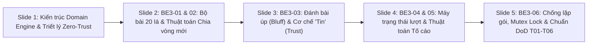

# KỊCH BẢN THUYẾT TRÌNH & SLIDE CHI TIẾT (5 SLIDES) — THÀNH VIÊN: HẢI
## CHỦ ĐỀ: AUTHORITATIVE CORE GAMEPLAY ENGINE (MODULE BE3-01 ĐẾN BE3-06)
**Dự án:** LIAR'S CARD 3D · **Môn học:** Game Network Programming (GNS)

---

> [!IMPORTANT]
> - **File trình chiếu PowerPoint (.pptx) chuẩn 16:9 đã tạo sẵn:** 
>   [`d:\FPT\Ky8\GNS\LIARS-CARD-\docs\HAI_CORE_GAMEPLAY_ENGINE_5SLIDES.pptx`](file:///d:/FPT/Ky8/GNS/LIARS-CARD-/docs/HAI_CORE_GAMEPLAY_ENGINE_5SLIDES.pptx)
>   *(Bạn có thể kéo-thả file này trực tiếp vào **Canva** hoặc **PowerPoint** để chỉnh sửa / đổi hiệu ứng trong 3 giây).*
> - **Thời lượng thuyết trình:** ~5 phút (tương đương 1 phút / slide).
> - **Mục tiêu ăn điểm:** Chứng minh được tư duy **Server-Authoritative**, khả năng chống gian lận (Anti-Cheat/Anti-Card Injection), xử lý bài ẩn (Imperfect Information), thuật toán xét Bluff/Joker và cơ chế chống xử lý lặp gói tin mạng (Idempotency & Mutex Locking).

---

## TỔNG HỢP 5 SLIDES CỦA HẢI



---

### SLIDE 1: VAI TRÒ & KIẾN TRÚC AUTHORITATIVE CORE ENGINE (BE3)
- **Tiêu đề Slide:** Vai Trò & Kiến Trúc Authoritative Core Engine (BE3)
- **Phụ đề:** Nguyên tắc Server-Authoritative 100%: Chống gian lận và quản lý tính toàn vẹn luật chơi
- **Hình ảnh minh họa:** `cam_07_seat_pov_table.png` (Góc nhìn từ ghế ngồi nhìn sang đối thủ & mặt bàn đấu).
- **Nội dung hiển thị trên Slide (Bullet Points):**
  - **Đảm nhận trọn vẹn "Bộ não" trận đấu:** Phụ trách toàn bộ 6 task cốt lõi `BE3-01` $\rightarrow$ `BE3-06` (Khởi tạo bộ bài, chia bài, máy trạng thái lượt, đánh bài úp, xét tố cáo, chống xử lý lặp).
  - **Nguyên tắc Zero-Trust Client:** Client Unity chỉ là tầng giao diện (Dumb Terminal); toàn bộ lá bài trên tay, giá trị bài ẩn, thứ tự lượt và rank bàn đều được lưu trữ và tính toán 100% trên Server.
  - **Cấu trúc phân tầng Domain rõ ràng:** `DeckActionsController` tiếp nhận REST request $\rightarrow$ `DeckActionService` / `ChallengeService` điều phối $\rightarrow$ `DeckRuleEngine` & `TurnStateMachine` thực thi quy tắc $\rightarrow$ `InMemoryMatchStore` lưu trữ an toàn luồng.
  - **Chuẩn hóa theo Sheet Technical Requirements:** Hoàn thành 100% tiêu chí từ `T01` đến `T06`, đảm bảo không có trạng thái kẹt (Deadlock).
- **Hộp kỹ thuật (Code Box):**
  ```csharp
  • DeckRuleEngine.cs: Kiểm tra tính hợp lệ bài đánh, tố cáo & thuật toán IsBluff
  • TurnStateMachine.cs: Xoay tua lượt theo SeatIndex, tự động skip người hết bài/chết
  • DeckRoundService.cs: Xáo Fisher-Yates, chia 5 lá cho AlivePlayers, random TableRank
  • DeckActionService.cs: Rút bài khỏi Hand, lưu LastPlay, kích hoạt SFX âm thanh 3D
  • ChallengeService.cs: Lật bài, xét Joker Wildcard, xác định người chịu phạt súng Nga
  ```

#### 🎙️ LỜI THOẠI THUYẾT TRÌNH CHI TIẾT (SLIDE 1):
> *"Kính thưa thầy và các bạn, em là Hải, phụ trách module Core Gameplay Engine của dự án Liar's Card 3D. 
> 
> Trong một tựa game bài mang tính lừa đảo và tâm lý chiến như Liar's Bar, bài toán hóc búa nhất về mặt Game Network chính là **Bảo mật thông tin ẩn (Imperfect Information)**. Nếu chúng ta để Client biết trước bài úp của đối thủ, hoặc để Client tự phán quyết xem mình có được đánh hay không, thì bất kỳ người chơi nào sử dụng công cụ can thiệp RAM hay bắt gói tin mạng đều có thể gian lận 100%. 
> 
> Vì lý do đó, toàn bộ kiến trúc mà em xây dựng tuân thủ triệt để mô hình **Server-Authoritative Zero-Trust**: Client Unity hoàn toàn chỉ đóng vai trò là một màn hình hiển thị và thu thập thao tác người dùng. Mọi dữ liệu về bài trên tay, thứ tự lượt đi, và việc ai là người phải chịu phát đạn súng Nga đều do hệ thống Backend của em nắm giữ và quyết định tuyệt đối."*

---

### SLIDE 2: BE3-01 & BE3-02 — BỘ BÀI 20 LÁ & THUẬT TOÁN CHIA VÒNG MỚI
- **Tiêu đề Slide:** BE3-01 & BE3-02: Bộ Bài 20 Lá & Thuật Toán Chia Vòng Mới
- **Phụ đề:** Xáo bài Fisher-Yates bảo mật, ràng buộc sức chứa bàn 4 người & thiết lập TableRank
- **Hình ảnh minh họa:** `cam_03_three_tables_wide.png` (Toàn cảnh 3 khu vực bàn đấu với đèn chiếu spotlight).
- **Nội dung hiển thị trên Slide (Bullet Points):**
  - **`BE3-01` — Cấu trúc bộ bài chuẩn:** Đúng 20 lá gồm 6 lá Ace (A), 6 lá King (K), 6 lá Queen (Q) và 2 lá Joker (Wildcard). Mỗi lá bài sinh ra có một `CardInstanceId` (GUID) duy nhất để theo dõi vòng đời.
  - **Ràng buộc toán học bất biến:** Tối đa 4 người chơi $\times$ 5 lá/người = 20 lá, vừa khít sức chứa bộ bài. Server kiểm tra `totalCardsNeeded <= 20` trước khi chia.
  - **Thuật toán xáo bài Fisher-Yates + CSPRNG:** Sử dụng `RandomNumberGenerator.GetInt32` bảo mật mật mã học, đảm bảo tính ngẫu nhiên công bằng, không thể dự đoán thứ tự chia.
  - **`BE3-02` — Khởi tạo vòng mới (`StartRound`):** Server lọc danh sách `AlivePlayers`, chia chính xác 5 lá cho mỗi người sống sót, random `TableRank` (A, K, Q), reset `LastPlay = null`, tăng `RoundNumber++` và `StateVersion++`.
  - **Xử lý khi bắn trượt (`ContinueRoundAfterMiss`):** Nếu người bóp cò súng Nga sống sót, Server giữ nguyên bài trên tay và TableRank, chỉ chuyển lượt tiếp theo mà không chia lại bài!
- **Hộp kỹ thuật (Code Box):**
  ```csharp
  // 1. Kiểm tra số người sống sót & bộ bài 20 lá
  const int cardsPerPlayer = 5;
  if (alivePlayers.Count * cardsPerPlayer > 20) throw new InvalidOperationException();

  // 2. Xáo bài Fisher-Yates bằng RandomNumberGenerator bảo mật
  var deck = CreateAndShuffleDeck();

  // 3. Chia chính xác 5 lá cho từng người chơi còn sống (AlivePlayers)
  int cardIndex = 0;
  foreach (var player in alivePlayers) {
      player.Hand.Clear();
      for (int i = 0; i < cardsPerPlayer; i++) player.Hand.Add(deck[cardIndex++]);
  }

  // 4. Chọn ngẫu nhiên TableRank bàn (A, K, Q) & chuyển lượt cho ghế ưu tiên
  match.TableRank = ValidTableRanks[RandomNumberGenerator.GetInt32(3)];
  match.CurrentTurnPlayerId = _turnStateMachine.GetInitialTurnPlayer(match, startingSeat)?.PlayerId;
  ```

#### 🎙️ LỜI THOẠI THUYẾT TRÌNH CHI TIẾT (SLIDE 2):
> *"Bước vào chi tiết kỹ thuật đầu tiên ở Slide 2 là hai task BE3-01 và BE3-02 trong phần phân công. 
> 
> Bộ bài trong Liar's Card được em thiết kế chuẩn gồm đúng 20 lá: 6 lá A, 6 lá K, 6 lá Q và 2 lá Joker. Các bạn có thể thấy đây là một con số tính toán rất chặt chẽ: bàn đấu tối đa 4 người chơi, mỗi người được chia đúng 5 lá bài, 4 nhân 5 vừa tròn 20 lá. 
> 
> Trong hàm `StartRound` của class `DeckRoundService`, em áp dụng thuật toán xáo bài Fisher-Yates kết hợp bộ sinh số ngẫu nhiên mật mã học `RandomNumberGenerator` của .NET. Điều này đảm bảo tính ngẫu nhiên tuyệt đối, client không thể đoán trước được quân bài tiếp theo. Sau đó, Server phát ngẫu nhiên TableRank của vòng đấu là A, K hoặc Q và thiết lập người đi đầu tiên. 
> 
> Đặc biệt, nhóm em có một xử lý rất tinh tế ở hàm `ContinueRoundAfterMiss`: khi người chơi bị phạt súng Nga mà bắn trúng buồng đạn rỗng và còn sống, Server sẽ giữ nguyên bài trên tay và giữ nguyên TableRank để ván đấu tiếp diễn tự nhiên, chứ không reset lại bài một cách vô lý."*

---

### SLIDE 3: BE3-03 — XỬ LÝ ĐÁNH BÀI ÚP (BLUFF) & CƠ CHẾ "TIN" (TRUST)
- **Tiêu đề Slide:** BE3-03: Xử Lý Đánh Bài Úp (Bluff) & Cơ Chế "Tin" (Trust)
- **Phụ đề:** Xác minh quyền sở hữu thẻ bài, cơ chế nói dối tự do, đồng bộ âm thanh 3D & nhánh đối thủ hết bài
- **Hình ảnh minh họa:** `cam_01_bar_overview.png` (Quán bar trung tâm với góc nhìn toàn sảnh).
- **Nội dung hiển thị trên Slide (Bullet Points):**
  - **Quy tắc đánh bài (`DeckRuleEngine.ValidatePlay`):** Cho phép đánh từ 1 đến 3 lá bài. Kiểm tra đúng pha `AwaitPlayOrChallenge`, đúng lượt người gọi và người chơi còn sống.
  - **Chống Hack Thẻ Bài (Anti-Card Injection):** Server tạo `HashSet` từ `player.Hand` và so khớp từng `cardId` gửi lên. Nếu client bịa ra ID thẻ bài không có trong tay $\rightarrow$ ném ngay ngoại lệ `CardNotOwned`!
  - **Bluff là hoàn toàn hợp lệ:** Server cố tình **KHÔNG** so sánh rank của lá bài với `TableRank` lúc đánh bài. Thẻ bài được rút khỏi Hand, đóng gói vào `LastPlay` (giấu mặt bài với các client khác).
  - **Đồng bộ âm thanh 3D thời gian thực:** Dựa vào số lá bài vừa đánh (1, 2 hay 3 lá), Server phát âm thanh tương ứng (`Danh_1`, `Danh_2`, `Danh_3`) đến đúng vị trí tọa độ ghế ngồi qua UDP Packet 10.
  - **Cơ chế "Tin" đặc biệt (`TrustAsync`):** Khi đối thủ trước đã đánh hết bài (`RemainingCardCount == 0`), người kế tiếp bị khóa lệnh đánh bài, chỉ được chọn "Tố" (Challenge) hoặc "Tin" (Trust). Nếu toàn bộ người chơi đều Tin $\rightarrow$ người hết bài an toàn $\rightarrow$ chia lại vòng mới!
- **Hộp kỹ thuật (Code Box):**
  ```csharp
  // 1. Kiểm tra người chơi thực sự sở hữu toàn bộ các lá bài gửi lên
  var handCardIds = new HashSet<string>(player.Hand.Select(c => c.CardInstanceId));
  foreach (var cardId in request.CardInstanceIds) {
      if (!handCardIds.Contains(cardId)) throw GameRuleException.CardNotOwned(match.StateVersion);
  }

  // 2. Rút bài khỏi tay người chơi & ghi nhận LastPlay ẩn mặt bài
  player.Hand.RemoveAll(c => playedCardIds.Contains(c.CardInstanceId));
  match.LastPlay = new LastPlay {
      PlayId = $"play_{Guid.NewGuid():N}", PlayerId = playerId,
      CardCount = playedCards.Count, Cards = playedCards, Resolved = false
  };

  // 3. Tự động chuyển lượt & Broadcast âm thanh đánh bài 3D theo số lượng lá
  _turnStateMachine.AdvanceAfterPlay(match, playerId);
  _gameBroadcastService?.BroadcastAudio(match, cardCount == 1 ? "Danh_1" : (cardCount == 2 ? "Danh_2" : "Danh_3"), playerId);
  ```

#### 🎙️ LỜI THOẠI THUYẾT TRÌNH CHI TIẾT (SLIDE 3):
> *"Sang Slide 3 là task BE3-03: Xử lý đánh bài úp (Bluff) và cơ chế Tin. 
> 
> Khi đến lượt, người chơi có quyền đánh từ 1 đến 3 lá bài. Để ngăn chặn việc dùng công cụ can thiệp gói tin gửi mã bài giả, hàm `ValidatePlay` của em tạo một tập hợp `HashSet` các ID lá bài có trong tay người chơi trên Server. Nếu có bất kỳ lá nào không thuộc sở hữu của người đó, Server sẽ từ chối ngay với mã lỗi `CardNotOwned`.
> 
> Tuy nhiên, luật chơi cho phép người chơi 'nói dối' (Bluff). Ví dụ bàn đang yêu cầu đánh quân K, bạn hoàn toàn có thể úp 3 quân Q xuống bàn nhưng vẫn tuyên bố là 3 quân K. Server tôn trọng điều này và cố tình không kiểm tra chất bài lúc đánh, mà chỉ bí mật rút 3 lá đó khỏi Hand và lưu vào đối tượng `LastPlay` trên Server mà không gửi chất bài cho các máy khách khác. Đồng thời Server kích hoạt âm thanh 3D `Danh_1`, `Danh_2` hoặc `Danh_3` tương ứng với số lá bài vừa ném xuống bàn.
> 
> Đặc biệt, nhóm em cài đặt thêm cơ chế 'Tin' (`Trust`): khi đối thủ trước đã đánh hết sạch bài trên tay, người tiếp theo không được đánh tiếp mà buộc phải đưa ra quyết định: Tố hay Tin. Nếu tất cả mọi người trên bàn đều chọn Tin thì người hết bài an toàn và vòng đấu kết thúc thành công."*

---

### SLIDE 4: BE3-04 & BE3-05 — MÁY TRẠNG THÁI LƯỢT & THUẬT TOÁN TỐ CÁO
- **Tiêu đề Slide:** BE3-04 & BE3-05: Máy Trạng Thái Lượt & Thuật Toán Tố Cáo
- **Phụ đề:** TurnStateMachine xoay tua theo SeatIndex, xét lá bài Joker Wildcard và xác định người chịu phạt
- **Hình ảnh minh họa:** `cam_04_revolver_closeup.png` (Cận cảnh khẩu súng lục Nga 6 buồng đạn trên bàn).
- **Nội dung hiển thị trên Slide (Bullet Points):**
  - **`BE3-04` — Điều phối lượt (`TurnStateMachine`):**
    - Xoay tua theo chiều kim đồng hồ quanh 4 ghế dựa vào `SeatIndex`.
    - Thuật toán `GetNextTurnPlayer`: Tự động nhảy qua (Skip) những người chơi đã chết (`!IsAlive`) hoặc đã đánh hết bài trong vòng hiện tại.
    - Khóa chặt trạng thái khi ván đấu chuyển sang xử phạt súng lục Nga (`Phase = PenaltyResolution`).
  - **`BE3-05` — Xử lý Tố cáo (`ChallengeService` & `DeckRuleEngine.IsBluff`):**
    - Thuật toán xét thật/dối: `IsBluff` trả về `true` nếu tồn tại ít nhất 1 lá bài mà `(Rank != TableRank VÀ Rank != Joker)`. Lá Joker đóng vai trò Wildcard hợp lệ tuyệt đối cho mọi TableRank!
    - **Phân định người thua cuộc:**
      - Nếu có Bluff (Người đánh nói dối) $\rightarrow$ Tố cáo thành công $\rightarrow$ Người đánh trước phải cầm súng Nga (`PenalizedPlayerId = LastPlay.PlayerId`).
      - Nếu không có Bluff (Người đánh nói thật) $\rightarrow$ Tố cáo sai $\rightarrow$ Người tố cáo phải cầm súng Nga (`PenalizedPlayerId = ChallengerId`).
    - Broadcast đồng bộ: Phát âm thanh "Tố" (`"To"`) và gửi gói UDP Packet 11 để khóa bàn, mở màn hình bóp cò súng.
- **Hộp kỹ thuật (Code Box):**
  ```csharp
  public bool IsBluff(List<Card> cards, string tableRank) {
      foreach (var card in cards) {
          // Lá bài hợp lệ nếu đúng TableRank hoặc là lá Joker Wildcard
          if (!card.MatchesRank(tableRank)) return true; // Phát hiện nói dối!
      }
      return false; // Toàn bộ lá bài đều trung thực hoặc Joker
  }

  // Trong ChallengeAsync: Phân định người chịu phạt súng Nga
  bool isBluff = _ruleEngine.IsBluff(lastPlay.Cards, match.TableRank);
  string penalizedPlayerId = isBluff ? lastPlay.PlayerId : challengerPlayerId;

  match.Phase = RoundPhase.PenaltyResolution;
  match.PenalizedPlayerId = penalizedPlayerId;
  _gameBroadcastService?.BroadcastPenaltyWaitingForTrigger(match, penalizedPlayerId, playerId, isBluff);
  ```

#### 🎙️ LỜI THOẠI THUYẾT TRÌNH CHI TIẾT (SLIDE 4):
> *"Tiếp theo ở Slide 4 là hai task BE3-04 và BE3-05: Máy trạng thái lượt và Thuật toán Tố cáo. 
> 
> Trong class `TurnStateMachine`, thuật toán `GetNextTurnPlayer` duyệt theo chiều kim đồng hồ quanh 4 vị trí ghế `SeatIndex`. Điểm cốt lõi là máy trạng thái tự động bỏ qua những người chơi đã bị bắn chết hoặc những người đã đánh hết bài trên tay, tránh tình trạng chuyển lượt vào người không thể đánh.
> 
> Khi một người chơi nghi ngờ đối thủ nói dối và bấm Tố cáo (Challenge), class `ChallengeService` sẽ gọi hàm `IsBluff` để lật bộ bài trong `LastPlay`. Thuật toán của em kiểm tra từng lá: nếu lá bài trùng với TableRank hoặc là lá **Joker Wildcard**, lá bài đó được tính là hợp lệ. Nếu phát hiện dù chỉ 1 lá nói dối, người đánh trước sẽ bị bắt quả tang và trở thành người chịu phạt. Ngược lại, nếu người đánh trước hoàn toàn trung thực, chính người bấm tố cáo sai sẽ phải nhận hình phạt súng Nga! 
> 
> Ngay sau đó, Server phát âm thanh 'Tố' qua mạng và bắn gói tin UDP Packet 11 báo cho cả phòng biết ai là người chuẩn bị phải cầm súng Nga lên đầu."*

---

### SLIDE 5: BE3-06 — CHỐNG XỬ LÝ LẶP, MUTEX LOCK & CHUẨN KỸ THUẬT T01-T06
- **Tiêu đề Slide:** BE3-06: Chống Xử Lý Lặp (Idempotency) & Mutex Tuần Tự Hóa
- **Phụ đề:** Per-Match SemaphoreSlim, SHA256 Payload Hash, StateVersion và hoàn thành 100% Technical Requirements
- **Hình ảnh minh họa:** `cam_08_aerial_isometric.png` (Toàn cảnh không gian quán bar nhìn từ trên cao).
- **Nội dung hiển thị trên Slide (Bullet Points):**
  - **Vấn đề mạng thực tế:** Người chơi click chuột liên tục, mạng Wi-Fi chập chờn khiến HTTP Client tự động retry gói tin $\rightarrow$ Nếu không xử lý, người chơi sẽ bị trừ bài 2 lần hoặc 2 người cùng tố cáo 1 lúc gây xung đột luồng!
  - **Lớp 1 — Khóa Mutex bất đồng bộ (`SemaphoreSlim`):** Mỗi `matchId` sở hữu một đối tượng `SemaphoreSlim(1,1)` riêng biệt trong `InMemoryMatchStore`. Mọi thao tác đánh bài/tố cáo trên cùng một bàn được tuần tự hóa 100%, trong khi các bàn khác chạy song song không nghẽn nhau.
  - **Lớp 2 — Cơ chế Idempotency với SHA256 PayloadHash:** Server tính toán mã hash từ `ActionId` + `ExpectedVersion` + danh sách `cardId`. Nếu gặp lại đúng `ActionId` đó, Server trả lại kết quả đã cache ngay mà tuyệt đối không trừ bài lần hai!
  - **Lớp 3 — Optimistic Concurrency qua StateVersion:** Mỗi thay đổi làm `StateVersion++`, mọi request mang version cũ lập tức bị từ chối với mã `409 STALE_STATE_VERSION`.
  - **Đối chiếu chuẩn Technical Requirements (Sheet 03):** Đáp ứng trọn vẹn `T01` (Player State), `T02` (Game State), `T03` (Gameplay State không kẹt), `T04` (Tiếp nhận Action), `T05` (Validation) và `T06` (Network Sync)!
- **Hộp kỹ thuật (Code Box):**
  ```csharp
  using (await _matchStore.LockMatchAsync(matchId)) // Khóa SemaphoreSlim(1,1) độc lập từng bàn
  {
      // 1. Kiểm tra ActionId & SHA256 Hash -> Chống trừ bài 2 lần khi client retry do lag mạng
      var existingAction = _matchStore.GetActionResult(matchId, request.ActionId);
      if (existingAction != null && existingAction.PayloadHash == payloadHash)
          return (PlayCardsResponse)existingAction.Result;

      // 2. Kiểm tra StateVersion chống race condition gói tin đến muộn
      if (match.StateVersion != request.ExpectedVersion)
          throw GameRuleException.StaleVersion(match.StateVersion);

      // 3. Thực thi nghiệp vụ an toàn -> match.StateVersion++ -> Lưu cache
      _matchStore.SaveActionResult(matchId, request.ActionId, payloadHash, response, match.StateVersion);
  }
  ```

#### 🎙️ LỜI THOẠI THUYẾT TRÌNH CHI TIẾT (SLIDE 5):
> *"Khép lại phần trình bày của em ở Slide 5 là task BE3-06: Chống xử lý lặp và Khóa tuần tự hóa đa luồng. Đây là phần kỹ thuật mạng mà em tâm đắc nhất. 
> 
> Khi chơi game qua Internet, việc người chơi bấm nút liên tục hoặc mạng lag khiến gói tin bị gửi lặp lại (retry) là điều rất hay xảy ra. Nếu Server không xử lý tốt, người chơi sẽ bị trừ bài 2 lần hoặc 2 người cùng bấm Challenge gần như cùng 1 mili-giây sẽ làm hỏng trạng thái ván đấu. 
> 
> Để triệt tiêu hoàn toàn rủi ro này, em đã thiết lập 3 lớp khiên bảo vệ:
> 1. Thứ nhất là cơ chế **Per-Match SemaphoreSlim Mutex**: mỗi bàn chơi có một khóa riêng, đảm bảo mọi request vào cùng một bàn phải xếp hàng tuần tự tuyệt đối, nhưng các bàn khác vẫn xử lý song song mà không bị nghẽn.
> 2. Thứ hai là cơ chế **Idempotency dựa trên ActionId và mã băm SHA256**: nếu client vô tình gửi lặp một request đã được xử lý, Server lập tức trả về kết quả đã cache mà không thực thi trừ bài lần hai.
> 3. Thứ ba là kiểm soát phiên bản **StateVersion**: loại bỏ các request đến muộn mang dữ liệu cũ.
> 
> Nhờ đó, module của em đã đáp ứng 100% các tiêu chí từ T01 đến T06 trong bảng Technical Requirements của nhóm. Và sau khi em đã xác định được ai là người thua cuộc sau pha tố cáo, trận đấu sẽ chuyển sang phần kịch tính nhất là Bóp cò súng Nga do bạn Tuân phụ trách. Em xin nhường lời cho bạn Tuân!"*

---

## 3. CÂU HỎI PHẢN BIỆN THƯỜNG GẶP CỦA GIẢNG VIÊN & CÁCH HẢI TRẢ LỜI

| Câu hỏi giảng viên có thể hỏi Hải | Cách trả lời tự tin, ăn điểm tối đa |
| :--- | :--- |
| **Q1: "Tại sao không dùng lock(object) thông thường của C# mà phải dùng SemaphoreSlim?"** | *"Dạ thưa thầy, vì toàn bộ phương thức trong `DeckActionService` và `ChallengeService` đều là **bất đồng bộ (`async/await`)** để không chặn luồng của Web Server. Từ khóa `lock` trong C# không cho phép dùng bên trong khối `await`. Do đó em sử dụng `SemaphoreSlim(1, 1)` kết hợp `await LockMatchAsync()` để vừa đảm bảo tính bất đồng bộ vừa khóa an toàn luồng."* |
| **Q2: "Nếu Client hack gửi lên một mảng CardId rỗng hoặc gửi 4 lá bài thì Server xử lý thế nào?"** | *"Dạ thưa thầy, trong hàm `ValidatePlay`, em kiểm tra ngay từ đầu: `cardInstanceIds.Count` bắt buộc phải từ 1 đến 3 lá, và phải có `Distinct().Count() == Count` (chống gửi trùng 1 lá 2 lần). Nếu vi phạm, Server lập tức ném lỗi `InvalidCardCount` và từ chối request ngay tại cửa."* |
| **Q3: "Làm thế nào để hai bàn chơi khác nhau không bị khóa lẫn nhau khi cùng đánh bài?"** | *"Dạ thưa thầy, trong `InMemoryMatchStore`, em lưu trữ khóa `SemaphoreSlim` theo từng `matchId` trong một từ điển `ConcurrentDictionary<string, SemaphoreSlim>`. Nhờ vậy, khóa chỉ áp dụng cục bộ cho trận đấu đó, 100 bàn chơi khác nhau có thể xử lý song song hoàn toàn độc lập."* |
| **Q4: "Lá bài Joker được xử lý như thế nào trong thuật toán IsBluff?"** | *"Dạ, lá Joker có giá trị rank đặc biệt là `Card.RankJoker`. Trong hàm `IsBluff`, phương thức `card.MatchesRank(tableRank)` trả về `true` nếu quân bài đó có rank trùng với TableRank HOẶC là Joker. Vì vậy, Joker luôn luôn là một lá bài trung thực dù bàn đang yêu cầu A, K hay Q."* |

